# Scalable and Highly Available Web Application Hosting on AWS

**Services:** EC2 · EBS · EFS · Application Load Balancer · Auto Scaling Group · VPC · Route 53

## Overview

Designed and deployed a scalable, highly available web architecture on AWS with no single point of failure. Traffic is distributed by an Application Load Balancer to EC2 instances in an Auto Scaling Group across multiple Availability Zones, with shared content stored on Amazon EFS.

The architecture follows a layered security approach: the internet-facing ALB accepts HTTPS traffic, application instances run in private subnets, and SSH access to private instances is restricted to a bastion host. The bastion host accepts SSH connections only from restricted public IP address.

## Architecture

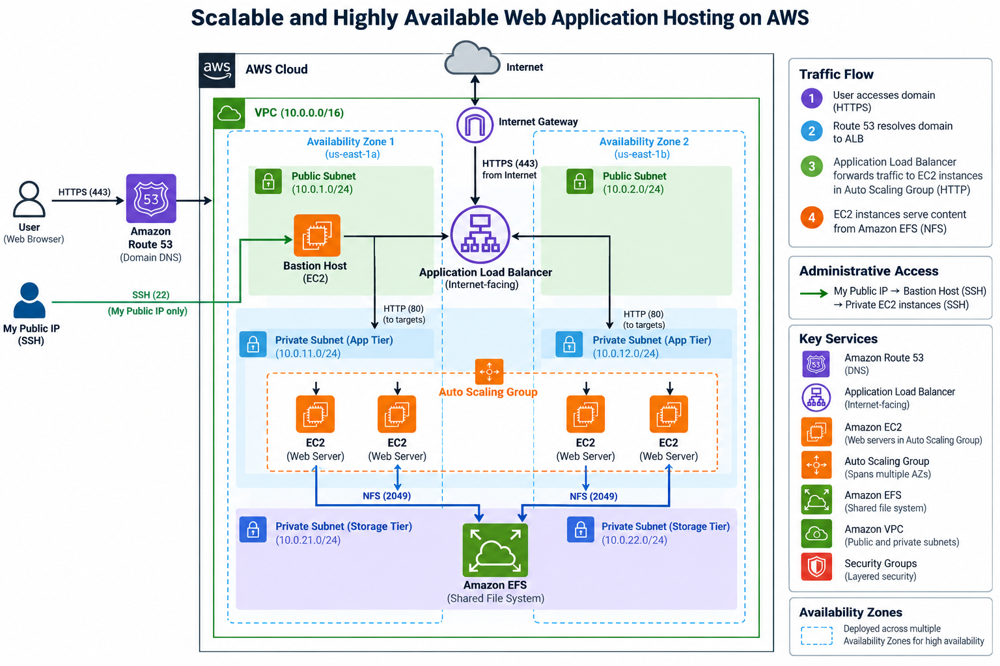

**Flow:** User → Route 53 → Application Load Balancer → EC2 instances (Auto Scaling Group, multiple AZs) → Amazon EFS

## Key Features

- **High availability:** EC2 instances run in multiple Availability Zones behind an ALB, so the app stays up during an instance or AZ failure.
- **Auto scaling:** the Auto Scaling Group adds instances during traffic spikes and removes them when load drops.
- **Private application tier:**  Auto Scaling EC2 instances are launched only in private subnets and do not accept direct public internet traffic.
- **Self-healing:** unhealthy instances are detected by ALB health checks and replaced automatically.
- **Centralized storage:** all instances serve the same content from EFS, so there is no need to sync files between servers.
- **DNS:** Route 53 points the domain to the ALB.
- **Bastion host access:** SSH access to private EC2 instances is permitted only from the bastion host security group.
- **Restricted administrative access:** The bastion host accepts SSH connections only from my public IP address.
- **ALB security:** The internet-facing ALB accepts HTTPS traffic on port 443 from public IP addresses.

## Implementation Steps

1. **VPC and Subnets:** Created a VPC with public and private subnets across two Availability Zones and an Internet Gateway. The public subnets host the ALB and bastion host, while private subnets host the application EC2 instances.
2. **Bastion Host Security Group:** Configured inbound SSH (TCP 22) to allow connections only from my public IP address (`MY_PUBLIC_IP/32`). Configured outbound traffic to allow all destinations.
3. **ALB Security Group:** Configured inbound HTTPS (TCP 443) from all public IPv4 addresses (`0.0.0.0/0`). Configured outbound HTTP (TCP 80) only to the application EC2 security group.
4. **Application EC2 Security Group:** Configured inbound SSH (TCP 22) only from the bastion host security group and inbound HTTP (TCP 80) only from the ALB security group. No direct public inbound access is permitted.
5. **EFS Security Group:** Configured inbound NFS (TCP 2049) only from the application EC2 security group. Left the default outbound rules unchanged.
6. **EFS:** Created an EFS file system in the required Availability Zones.
7. **Launch Template:** Configured Amazon Linux 2023 with [`scripts/user-data.sh`](scripts/user-data.sh) to install Apache and mount EFS. Configured the Auto Scaling instances to launch only in private subnets and use the application EC2 security group.
8. **Target Group and ALB:** Created a target group with HTTP health checks and an internet-facing ALB deployed across public subnets in both Availability Zones. Configured the ALB security group to accept HTTPS traffic.
9. **Auto Scaling Group:** Attached the Auto Scaling Group to the ALB target group and configured it to launch instances across private subnets in both Availability Zones, with a CPU-based target tracking scaling policy.
10. **Route 53:** Created an Alias record pointing the domain to the ALB and configured an HTTPS listener with an appropriate TLS certificate.

## Security Group Rules

| Security Group | Direction | Protocol / Port | Source / Destination |
|---|---|---|---|
| Bastion Host SG | Inbound | SSH / TCP 22 | My public IP (`MY_PUBLIC_IP/32`) |
| Bastion Host SG | Outbound | All traffic | All destinations |
| ALB SG | Inbound | HTTPS / TCP 443 | `0.0.0.0/0` |
| ALB SG | Outbound | HTTP / TCP 80 | Application EC2 SG |
| Application EC2 SG | Inbound | SSH / TCP 22 | Bastion Host SG |
| Application EC2 SG | Inbound | HTTP / TCP 80 | ALB SG |
| Application EC2 SG | Outbound | All traffic | All destinations |
| EFS SG | Inbound | NFS / TCP 2049 | Application EC2 SG |

## Testing

| Test | Expected Result |
|---|---|
| Access the application through the ALB domain over HTTPS | Page loads successfully from EFS |
| Attempt SSH to the bastion from an allowed public IP | SSH connection succeeds |
| Attempt SSH to the bastion from an unauthorized public IP | Connection is blocked |
| SSH to a private EC2 instance through the bastion | Access succeeds |
| Attempt direct SSH to a private EC2 instance from the internet | No direct public access |
| Attempt direct HTTP access to a private EC2 instance from the internet | No direct public access |
| Terminate an application instance | ALB routes traffic to healthy instances; ASG launches a replacement |
| Generate CPU load | ASG scales out and later scales back in |

## Screenshots

| ALB | Auto Scaling |
|---|---|
| 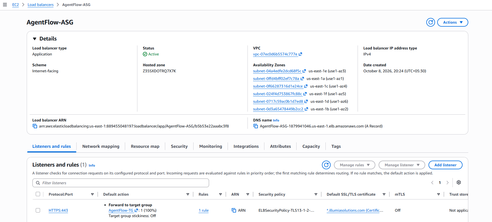 | 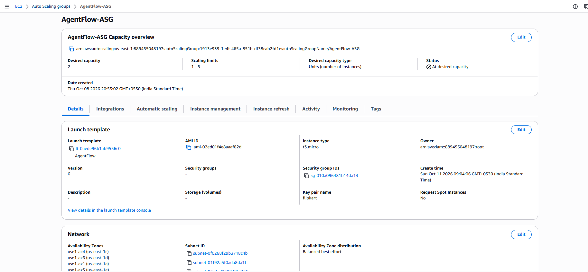 |

| Security Groups |
|---|---|
| 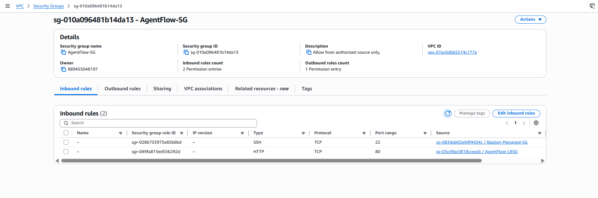 | 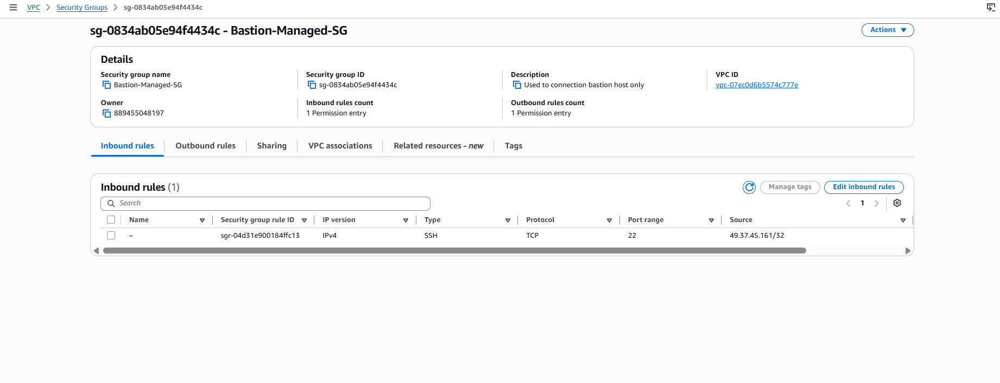 |
| 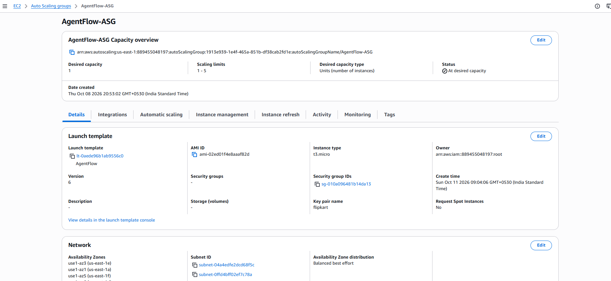 |  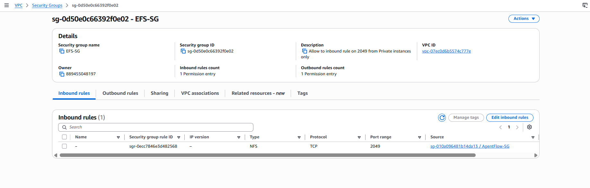|
| 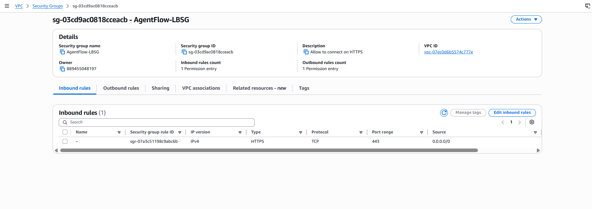 | 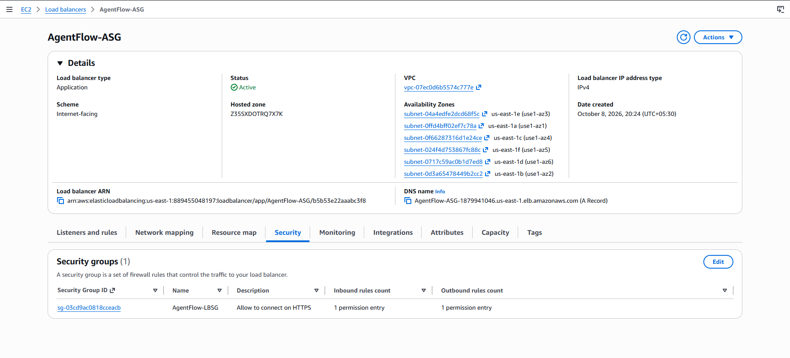 |

| Targets Groups |
|---|---|
| 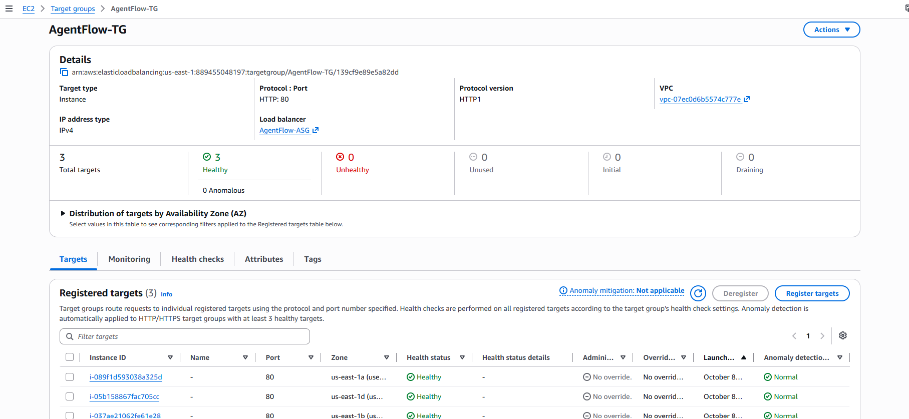 |

| EFS | EFS Mount on EC2 |
|---|---|
| 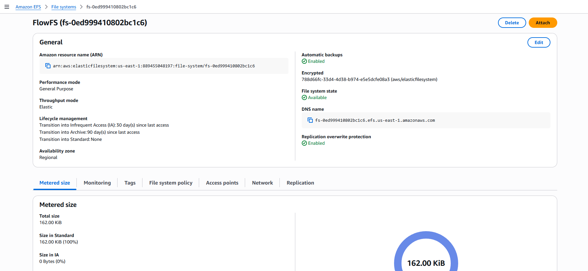 | 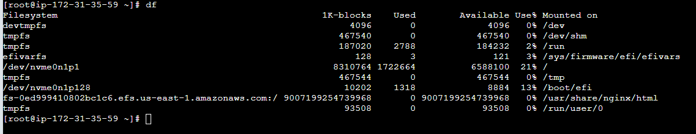 |

| EC2 |
|---|---|
| 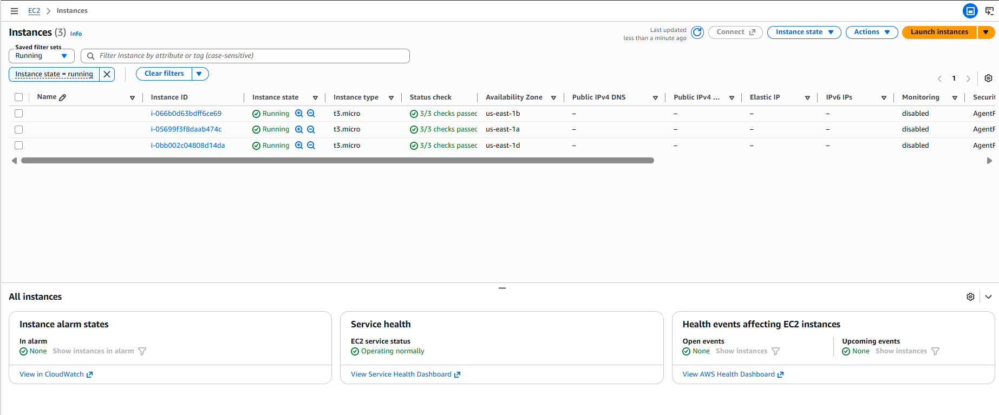 |

| Applications |
|---|---|
| 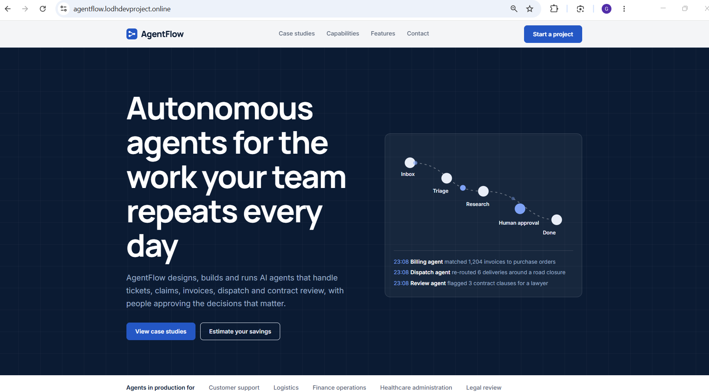 |

## What I Learned

- Designing for high availability across multiple Availability Zones
- Using ALB health checks with Auto Scaling for self-healing
- Hosting application instances in private subnets and restricting direct public access.
- Using a bastion host for controlled SSH administration.
- Sharing content across instances with EFS instead of instance storage
- Layering security groups so each tier only accepts traffic from the tier in front of it
